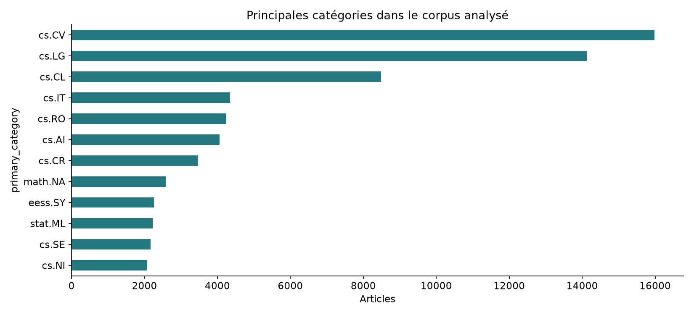
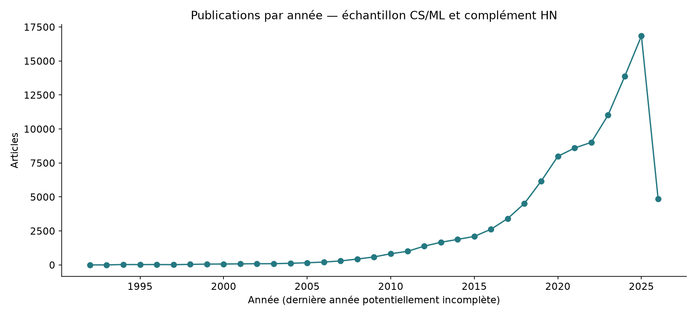
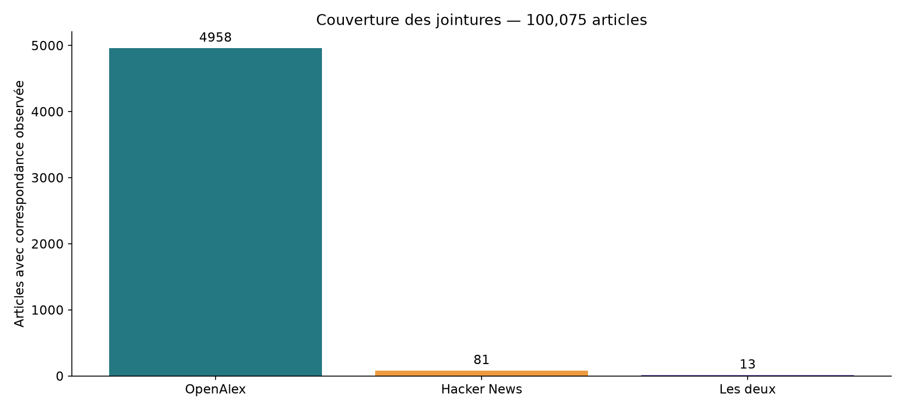
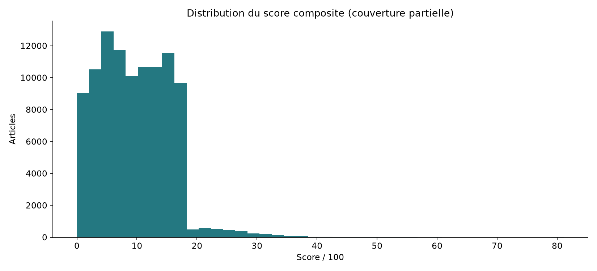
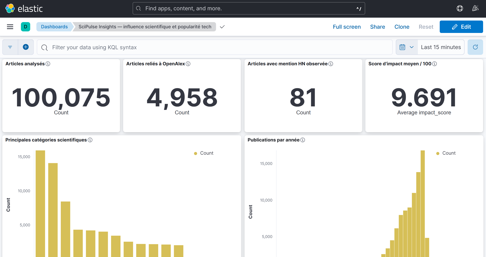
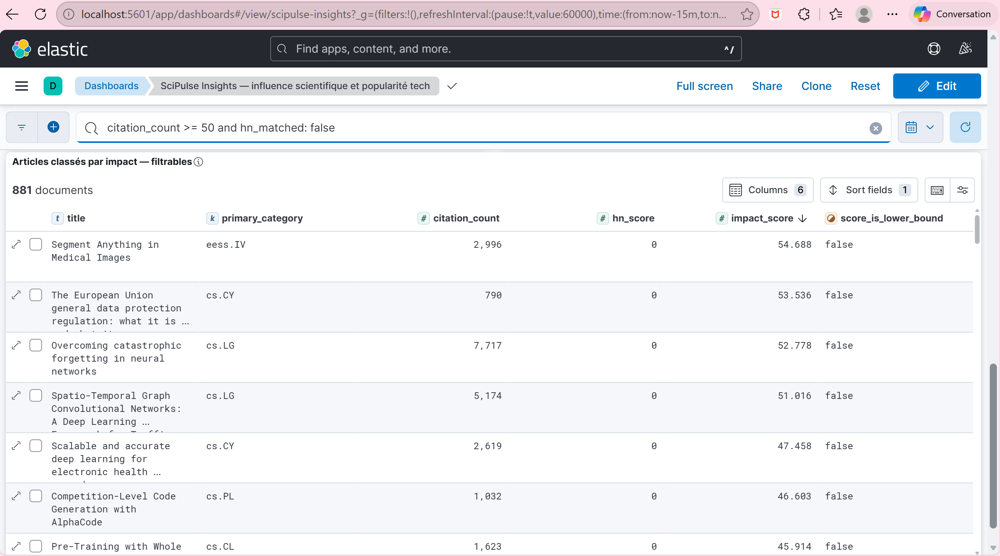
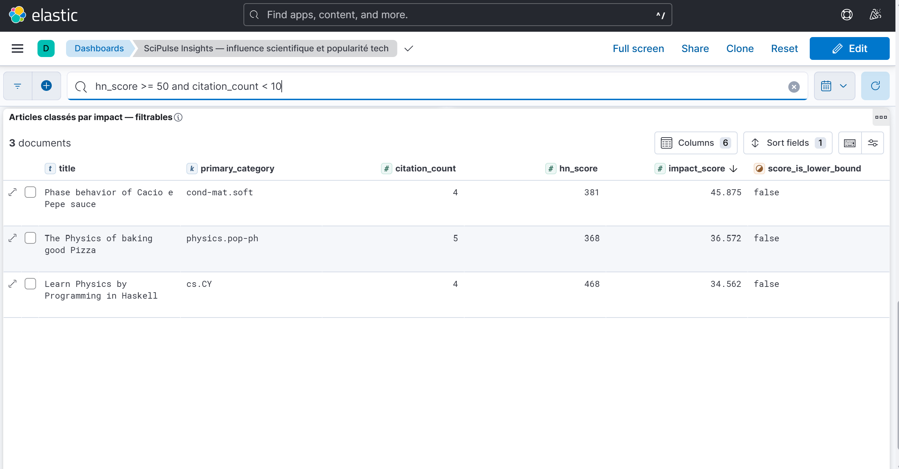

# Résultats — du pipeline au dashboard Kibana augmenté


Exécution Spark : `8deb9621-f960-41b5-8e00-04841edec07a`

| Indicateur | Valeur |
|---|---:|
| Articles enrichis par Spark | 100,075 |
| Articles reliés à OpenAlex | 4,958 (4.95%) |
| Articles liés à HN | 81 (0.08%) |
| Correspondances communes aux trois sources | 13 |

## Qualité et nettoyage

- **arxiv** : 100,075 lignes Bronze, 100,075 lignes Silver, 0 doublons de clé détectés ; qualité : 7/7 contrôles réussis.
- **hn** : 6,998 lignes Bronze, 1,019 lignes Silver, 5979 doublons de clé détectés ; qualité : 6/6 contrôles réussis.
- **citations** : 5,030 lignes Bronze, 4,970 lignes Silver, 60 doublons de clé détectés ; qualité : 5/5 contrôles réussis.

Les compteurs Silver sont ceux des manifestes lus à la génération du rapport ; le polling HN peut les actualiser après le calcul Spark.

Les résumés courts sont conservés et signalés. Les DOI et identifiants sont harmonisés avant les jointures. Les citations inconnues restent nulles.

## Interprétation des résultats


Ces résultats décrivent la collecte effectivement disponible. Un résultat nul est documenté comme tel. Le score mesure une combinaison explicite d’influence académique, d’attention tech et de récence ; il n’est pas une mesure objective de qualité.

## Articles les mieux classés

| ArXiv | Titre | Citations | HN | Score |
|---|---|---:|---:|---:|
| 2501.12948 | DeepSeek-R1: Incentivizing Reasoning Capability in LLMs via Reinforcement Learning | 1107 | 1351 | 81.082 |
| 1608.08225 | Why does deep and cheap learning work so well? | 392 | 434 | 59.4114 |
| 2308.00676 | Electronic structure of the putative room-temperature superconductor Pb$_9$Cu(PO$_4$)$_6$O | 43 | 551 | 55.9885 |
| 2307.16802 | Semiconducting transport in Pb$_{10-x}$Cu$_x$(PO$_4$)$_6$O sintered from Pb$_2$SO$_5$ and Cu$_3$P | 36 | 613 | 55.425 |
| 2304.12306 | Segment Anything in Medical Images | 2996 | 0 | 54.6881 |
| 2510.02861 | The European Union general data protection regulation: what it is and what it means | 790 | 0 | 53.5362 |
| 1612.00796 | Overcoming catastrophic forgetting in neural networks | 7717 | 0 | 52.778 |
| 1709.04875 | Spatio-Temporal Graph Convolutional Networks: A Deep Learning Framework for Traffic Forecasting | 5174 | 0 | 51.0163 |
| 2308.01192 | Observation of zero resistance above 100$^\circ$ K in Pb$_{10-x}$Cu$_x$(PO$_4$)$_6$O | 13 | 779 | 50.9299 |
| 2108.10984 | Crypto Wash Trading | 25 | 572 | 49.8145 |

## Visualisations









## Limites et recommandations

1. Augmenter la couverture OpenAlex au-delà du lot initial, sans remplacer les absences par zéro.
2. Collecter HN sur une période prolongée ; la recherche historique utilisée ne constitue pas un recensement exhaustif.
3. Comparer les scores à couverture et époque comparables ; les maxima de normalisation sont propres au run.
4. Exclure l’année courante des comparaisons de croissance annuelle complète.
5. Le complément HN du corpus introduit un biais de sélection : les corrélations éventuelles ne doivent pas être généralisées au corpus mondial.

Les graphiques ci-dessus sont des illustrations statistiques, distinctes des six captures Kibana personnelles présentes. Le générateur de documents est facultatif et peut rester hors de Git. Les détails méthodologiques, tests et sources figurent dans [METHODOLOGIE_PROJET.md](METHODOLOGIE_PROJET.md).

## Écriture Gold et intégration Airflow

Le rapport enregistré contrôle 100,075 lignes Spark et 100,075 documents Elasticsearch.
Contrôles de cohérence réussis : 7/7. La formule du score est vérifiée sur 100 documents.
Le DAG principal utilise un BashOperator pour soumettre Spark, puis contrôler la Gold et publier Kibana. La preuve enregistrée des dix tâches réussies figure dans reports/airflow_cluster_execution.json.

## Dashboard Kibana augmenté

Le dashboard **SciPulse Insights** lit uniquement l'index Gold `arxiv-papers-enriched`. Il présente le nombre d'articles, la couverture OpenAlex et HN, le score d'impact moyen, les catégories, les publications par année, les profils d'impact, la croissance des publications et un tableau d'articles trié par score.

Adresse : http://localhost:5601/app/dashboards#/view/scipulse-insights

Dans la barre KQL, appliquer successivement :

```text
citation_count >= 50 and hn_matched: false
```

Ce filtre sélectionne les articles très cités sans mention HN observée dans la collecte.

```text
hn_score >= 50 and citation_count < 10
```

Ce filtre sélectionne les articles populaires sur HN et peu cités parmi ceux dont les citations sont connues. Les seuils 50 et 10 sont des choix de démonstration.

Les deux filtres ont été vérifiés dans Kibana par l'utilisatrice au cours de la revue. Le rapport navigateur enregistré dans `reports/browser_checks.json` ne relevait aucune erreur visible sur le dashboard et confirmait 4 063 articles pour le filtre `primary_category: "cs.AI"`. Ce rapport décrit une vérification antérieure, pas une surveillance continue.

**Limite :** le tableau de croissance utilise `growth_pct`, calculé sur les publications. Il ne classe pas les sous-domaines selon une croissance combinée des citations et du signal HN. Ce cas d'usage, proposé comme exemple dans le brief, n'est donc pas démontré par ce panneau.

## Captures personnelles réalisées

Les six captures `scipulse-kibana0.png` à `scipulse-kibana5.png` ont été examinées. Voir [leur inventaire](../artifacts/screenshots/README.md). Les résultats filtrés visibles sont de 881 articles très cités sans HN observé et 3 articles populaires HN peu cités.






